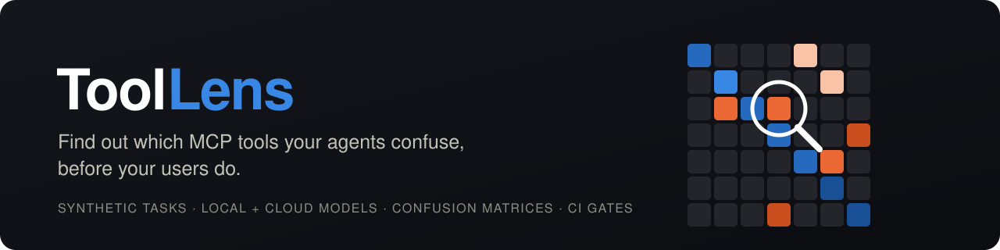
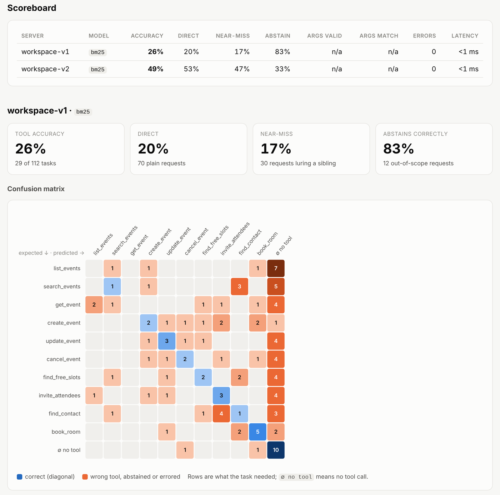
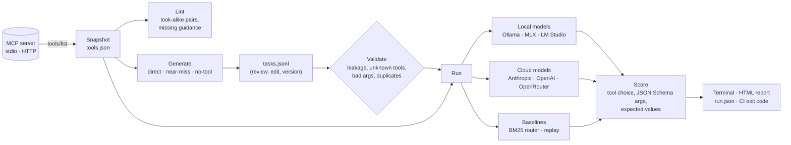
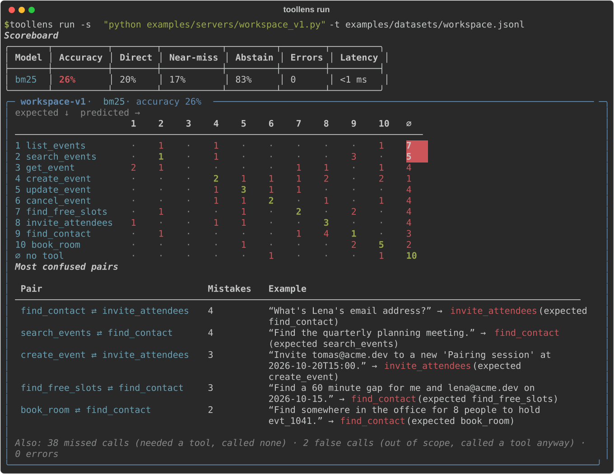
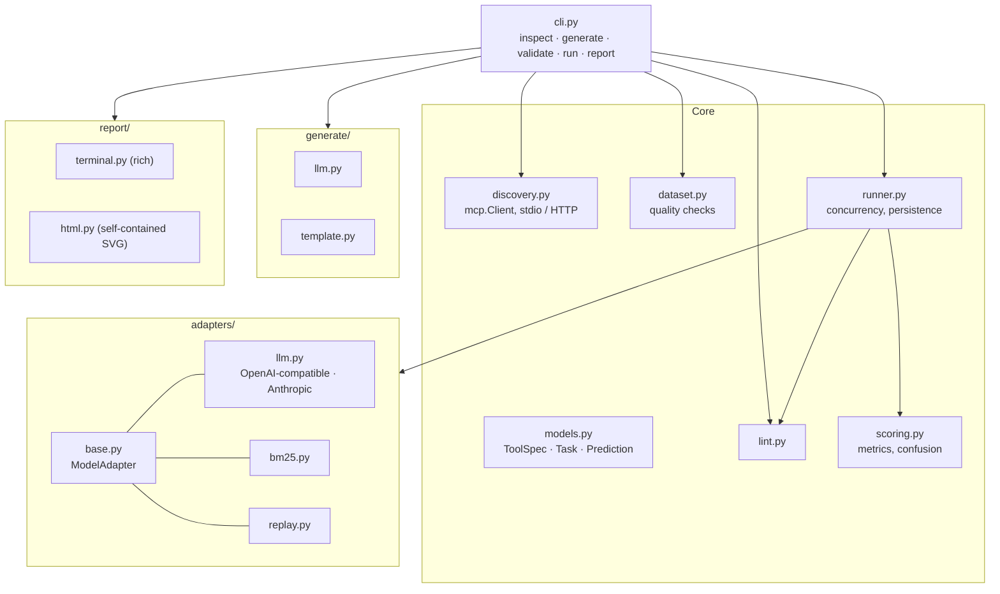

<p align="center">
  
</p>

<p align="center">
  <a href="https://github.com/danivijay/toollens/actions/workflows/ci.yml"></a>
  
  
  <a href="LICENSE"></a>
</p>

<p align="center">
  <a href="#quickstart">Quickstart</a> ·
  <a href="#how-it-works">How it works</a> ·
  <a href="#case-study-same-tools-better-words">Case study</a> ·
  <a href="#use-it-in-ci">CI</a> ·
  <a href="#testing">Testing</a> ·
  <a href="#roadmap">Roadmap</a>
</p>

---

**ToolLens is an evaluation harness for [Model Context Protocol](https://modelcontextprotocol.io) servers.** You point it at a server. It generates realistic, labelled user requests from the server's tools. Then it runs local and cloud models against those requests and shows which tools the models mix up, how often, and why.

```bash
toollens run -s "python my_server.py" -t tasks.jsonl -m ollama:qwen3:4b -m anthropic:claude-sonnet-4-5 --html report.html
```

## The problem

Spec conformance tells you whether your MCP server *speaks* the protocol. It doesn't tell you whether an agent can **use** the server.

Agents fail at tool selection quietly. A server ships `search_events`, `list_events` and `get_event`, each described in three words. The model picks the wrong one a third of the time. Nobody notices until a user asks why "what's on Thursday" returned nothing. Small local models have the hardest time, and so do tool-RAG routers that pre-select tools by retrieval. Those are the setups people increasingly run.

Today the feedback loop is anecdotal: trial and error in a chat window. ToolLens turns it into a number you can track, a matrix you can read, and a gate you can put in CI.

## What it does

| | |
|---|---|
| 🔎 **Inspect and lint** | Connects over stdio or Streamable HTTP. Snapshots every tool and flags confusion risks *before* any model runs: look-alike tool pairs, missing "use this when / not for" guidance, undocumented parameters, oversized schemas. It also estimates the token cost of your tool list. |
| 🧪 **Generate synthetic tasks** | A strong model writes direct requests, **near-miss** requests that lure toward a sibling tool, and **out-of-scope** requests where the right answer is to call nothing. The output is validated, de-duplicated and checked for label leakage, then saved as reviewable JSONL. An offline template generator covers smoke tests. |
| 🤖 **Run any model** | One harness for Ollama, MLX (`mlx_lm.server`), LM Studio, llama.cpp, vLLM, OpenAI, OpenRouter, Anthropic, an offline BM25 tool router, or replayed logs from your own agent. |
| 📊 **Explain the failures** | Tool accuracy split by direct, near-miss and no-tool tasks. Per-tool precision and recall, a confusion matrix, the most-confused pairs with the actual prompts that tripped the model, argument validity against the JSON Schema, and argument correctness. |
| 🚦 **Gate it** | `--fail-under 0.9` turns a run into a CI check. `toollens report run_a run_b` shows what a description change did. |

<picture>
  <source media="(prefers-color-scheme: dark)" srcset="docs/img/report-dark.png">
  
</picture>

<sub>The HTML report is a single self-contained file with light and dark mode and hover detail on every cell. A sample is in <a href="docs/sample-report.html"><code>docs/sample-report.html</code></a> (download it and open it in a browser).</sub>

## How it works



Each stage reads and writes plain files, so you can stop anywhere. Generate once with a strong model, hand-review the tasks, commit them, and run the same fixed set against every model and every version of your server. Fixed datasets are what make results comparable over time.

**Scoring rules**

1. A task is correct when the model calls the expected tool, or calls nothing when no tool fits.
2. For models that produce arguments, ToolLens also checks that the arguments **validate** against the tool's `inputSchema` and **contain** the values the request stated. Matching is case-insensitive. Free text may sit inside a longer value (`"budget"` matches `"Q3 budget review"`), but identifiers, emails and dates must match exactly (`evt_1` never matches `evt_1041`). Lists must contain every expected item, in any order.
3. Missed calls (needed a tool, called none), false calls (out of scope, called one anyway) and errors (HTTP failures, malformed JSON, invented tool names) are counted separately from tool-to-tool confusion. They need different fixes.

## Quickstart

```bash
git clone https://github.com/danivijay/toollens && cd toollens
python -m venv .venv && source .venv/bin/activate
pip install -e .
```

**The 60-second demo runs fully offline: no GPU, no API key.**

```bash
# 1. Lint the "before" server: ten calendar tools with terse descriptions
toollens inspect -s "python examples/servers/workspace_v1.py"

# 2. Score it with the offline BM25 router on the bundled 112-task dataset
toollens run -s "python examples/servers/workspace_v1.py" -t examples/datasets/workspace.jsonl

# 3. Score the "after" server: same tools, rewritten descriptions
toollens run -s "python examples/servers/workspace_v2.py" -t examples/datasets/workspace.jsonl

# 4. Compare the two runs side by side
toollens report runs/*-workspace-v1 runs/*-workspace-v2 --html report.html
```

<p align="center">
  
</p>

### Evaluate your own server with a local model (Apple Silicon friendly)

```bash
# Any MCP server: a command (stdio) or a URL (Streamable HTTP)
toollens inspect -s "npx -y @modelcontextprotocol/server-filesystem ~/notes" --save tools.json

# Ollama
ollama pull qwen3:4b
toollens run --tools tools.json -t tasks.jsonl -m ollama:qwen3:4b

# MLX on a Mac: start an OpenAI-compatible server, then point ToolLens at it
mlx_lm.server --model mlx-community/Qwen3-4B-4bit --port 8080
toollens run --tools tools.json -t tasks.jsonl -m mlx:mlx-community/Qwen3-4B-4bit
```

A 4B to 8B instruct model with tool calling runs a 100-task suite in a few minutes on an M-series laptop. The model needs native tool-calling support; models without it show up as errors, not as wrong answers.

### Generate a task set

```bash
export ANTHROPIC_API_KEY=...                       # or use -m openai:<model> / -m ollama:<model>
toollens generate --tools tools.json -o tasks.jsonl --per-tool 6 --near-miss 4 --no-tool 8
toollens validate --tools tools.json -t tasks.jsonl --min-per-tool 8
```

The generator sees the **whole** tool list plus the look-alike pairs found by the linter, so its near-miss tasks aim at real weak spots. It drops anything that would make scores meaningless: prompts that name their own answer, unknown argument names, invented distractor tools and duplicates. **Read the file before you trust a score**, because a synthetic dataset is a hypothesis about your users.

Prefer zero cost? `--generator template` builds deterministic tasks from schemas alone. They echo the tools' own wording, so use them as smoke tests (are tools reachable, do arguments validate?) rather than as a confusion measure.

### Model specs

| Spec | Where it goes | Notes |
|---|---|---|
| `bm25` / `bm25:<min_score>` | built in | Offline lexical router; abstains below the score threshold (default 1.0) |
| `ollama:<model>` | `http://localhost:11434/v1` | |
| `mlx:<model>` | `http://localhost:8080/v1` | `mlx_lm.server` |
| `lmstudio:<model>` | `http://localhost:1234/v1` | |
| `llamacpp:<model>`, `vllm:<model>` | `:8080`, `:8000` | |
| `openai:<model>` | OpenAI | `OPENAI_API_KEY` |
| `openrouter:<model>` | OpenRouter | `OPENROUTER_API_KEY` |
| `anthropic:<model>` | Anthropic Messages API | `ANTHROPIC_API_KEY` |
| `openai-compat:<model>` | `--base-url` | Anything else that speaks `/chat/completions` |
| `replay:<file.jsonl>` | your logs | Score decisions your own agent already made |

Every model gets the same system prompt, the same tools in its native wire format, and temperature 0 (dropped automatically for reasoning models that reject it). Pass `-m` several times to compare models in one run. Keys come from each provider's environment variable. ToolLens refuses a single `--api-key` or `--base-url` when a run mixes providers, so one provider's key is never sent to another.

## Case study: same tools, better words

The repo ships two versions of a 10-tool calendar server. **Their names, arguments and behaviour are identical** (a test enforces that). Only the descriptions differ:

| Tool | v1 description | v2 description |
|---|---|---|
| `update_event` | *Update an event.* | *Change an existing event: reschedule or move it to a new time, rename it, or make it longer or shorter. Not for cancelling (use cancel_event) or adding people (use invite_attendees).* |
| `cancel_event` | *Set event status.* | *Cancel, call off or delete a meeting so it no longer happens; attendees are told by default. Not for moving it to another time (use update_event).* |

Both were scored against the bundled dataset: 112 hand-reviewed tasks, of which 70 are direct, 30 near-miss and 12 out of scope. The model was the offline BM25 router, which is how retrieval-based tool pre-selection sees a server:

| Server | Tool accuracy | Direct | Near-miss | Correctly abstains | Lint warnings | Tool list size |
|---|---:|---:|---:|---:|---:|---:|
| v1 (terse) | 26% | 20% | 17% | 83% | 25 | ≈781 tokens |
| v2 (rewritten) | **49%** | **53%** | **47%** | 33% | 2 | ≈1,436 tokens |

Three things the report makes visible that a chat session would not:

- **Recall nearly doubled, and you can see where.** In v1, 38 of 100 requests that needed a tool matched *nothing*: three-word descriptions give a retriever nothing to hold on to. In v2 that falls to 6.
- **Descriptions are a trade-off, not a free win.** Richer text also gave out-of-scope requests more to match ("book me a flight to Mumbai" now lands on `book_room`), so false calls rose from 2 to 8. The tool list costs nearly twice the tokens.
- **Static lint is a first filter, not a verdict.** It found every v1 problem, but on v2 it flagged `get_event` against `cancel_event` and `book_room`, which barely confuse. Meanwhile the real remaining hot spots, `list_events` ⇄ `find_free_slots` (5 mistakes) and `update_event` ⇄ `cancel_event` (4), already reference each other and pass lint. Only a run against tasks finds those.

> **Read these numbers honestly.** BM25 rewards shared vocabulary, so it overstates how much wording matters to a capable LLM. The dataset was also written by the same author as the v2 descriptions. Treat the demo as a reproducible illustration of the workflow, then run your own model with `-m ollama:...` or `-m anthropic:...` to get the number that matters for your stack. A regression test keeps the direction of the result honest (v2 must beat v1 by at least 15 points), and CI re-runs the v2 demo on every push.

## Lint rules

| Code | Severity | What it catches |
|---|---|---|
| `TL000` | error | Duplicate tool names |
| `TL001` | error / warning | Missing description, or one shorter than 40 characters |
| `TL002` | warning / info | Parameters without descriptions |
| `TL003` | warning / info | Look-alike tool pairs (IDF-weighted description similarity plus name overlap). Warning when neither description references the other; info when they do |
| `TL004` | info | A tool with look-alike siblings but no "use this when / not for / instead of" guidance |
| `TL005` | info | A single tool definition over ≈400 tokens |
| `TL006` | error | `required` lists a parameter that `properties` doesn't define |
| `TL007` | info | Generic names such as `run`, `query`, `execute` |

`toollens inspect` exits 1 on errors, and with `--strict` on warnings too.

## Use it in CI

```yaml
# .github/workflows/toollens.yml
name: tool-usability
on: [pull_request]
jobs:
  toollens:
    runs-on: ubuntu-latest
    steps:
      - uses: actions/checkout@v4
      - uses: actions/setup-python@v5
        with: { python-version: "3.12" }
      - run: pip install "toollens @ git+https://github.com/danivijay/toollens"
      - run: toollens inspect -s "python server.py" --strict
      - run: toollens validate -s "python server.py" -t eval/tasks.jsonl
      - run: toollens run -s "python server.py" -t eval/tasks.jsonl -m bm25 --fail-under 0.8 --html report.html
      - uses: actions/upload-artifact@v4
        with: { name: toollens-report, path: report.html }
```

Swap `-m bm25` for a hosted model (with the API key as a secret) when you want an LLM in the loop on every PR.

## Architecture



The design choices that matter:

- **Plain `httpx` instead of vendor SDKs.** Two wire formats (OpenAI-compatible and Anthropic) cover nearly every provider and every local runtime, and every request is testable with `httpx.MockTransport`.
- **Adapters never raise.** A timeout, a 500 or malformed tool arguments become a scored `⚠ error` for that task, so one bad response can't sink a 500-task run.
- **Generation is separate from evaluation.** Tasks are data you review and commit. Comparing models only means something when they face the same fixed set.
- **Built on the official `mcp` Python SDK 2.x**, so a server speaking the stateless 2026-07-28 protocol and an older one using the `initialize` handshake both work without configuration.

## Testing

```bash
pip install -e ".[dev]" pytest-cov
pytest --cov=toollens          # 88 tests, ~97% line coverage, ~10 s
pytest -m "not integration"    # skip the tests that spawn real servers
```

| Layer | What is verified |
|---|---|
| **Scoring** | Accuracy by task kind, per-tool precision, recall and F1, confusion counts, abstention precision and recall, missed versus false calls (errors never double-count), JSON Schema argument validation, argument matching (case, free-text substrings, exact identifiers, numeric types, unordered lists, nested objects) |
| **Model adapters** | The exact request body for OpenAI-compatible and Anthropic APIs (system prompt, tool format, `tool_choice`, auth headers), response parsing, the reasoning-model temperature fallback, and graceful handling of HTTP 500s, malformed JSON, non-object arguments and hallucinated tool names. All use mocked transports, with no network. |
| **Synthetic data** | The template generator is deterministic and its arguments validate against real schemas. The LLM generator strips unknown parameters and leaking prompts, de-duplicates, and repairs or downgrades invalid near-misses. The bundled dataset passes every quality check, and v1 and v2 expose identical contracts. |
| **Lint** | Every rule fires on a crafted example, and disambiguating descriptions lower pair risk |
| **Runner** | Multi-model runs, the concurrency limit is honoured exactly, run directories round-trip, and empty task sets, duplicate models and tasks expecting unknown tools are rejected |
| **CLI** | Every command, its exit codes (`--strict`, `--fail-under`, bad model specs, malformed or empty task files, missing runs) with no tracebacks, the cross-provider credential guard, and HTML output |
| **Integration** | Discovery against the real demo servers over **stdio and Streamable HTTP**, committed snapshots kept in sync with the servers, real tool calls, and the case-study claim as a regression test |

CI runs the suite on Ubuntu and macOS across Python 3.10 to 3.13, then re-runs the demo end to end and uploads the HTML report as an artifact.

## Project layout

```
src/toollens/        library and CLI
examples/servers/    workspace_v1.py (terse) · workspace_v2.py (rewritten) · shared in-memory backend
examples/datasets/   workspace.jsonl: 112 labelled tasks (direct, near-miss, no-tool)
examples/snapshots/  tool snapshots for offline runs
tests/               88 tests (unit, contract and integration)
docs/                sample report and images
```

## Roadmap

- [ ] **Description optimizer loop**: an agent rewrites the worst-scoring descriptions, re-runs the eval, and keeps only changes that measurably help (DSPy-style, applied to MCP)
- [ ] Repeated trials with confidence intervals for non-deterministic models
- [ ] Multi-step tasks (search, then act) using the server's real responses
- [ ] Tool-RAG evaluation: top-k retrieval recall for embedding routers
- [ ] A GitHub Action wrapper and PR comments with the score delta
- [ ] Public scorecards for popular registry servers

## FAQ

**Why ship a BM25 "model" at all?** It is deterministic, free and offline, which makes it the right engine for tests and CI. It is also a faithful stand-in for the retrieval step many agent frameworks put in front of the LLM. If BM25 can't separate two tools, your retriever probably can't either.

**Does ToolLens call my tools?** No. It evaluates the *decision*: which tool, with which arguments. Nothing is executed, so it is safe to point at servers that write data.

**What about servers with 100+ tools?** Lint and runs scale linearly. The confusion matrix gets wide, so start with the "most confused pairs" list, which is sorted by impact.

## License

[MIT](LICENSE) © 2026 Dani Vijay
